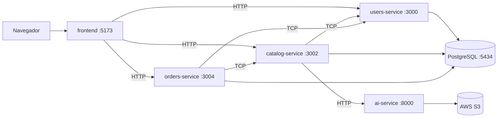

# AgroTrace

**AgroTrace** es una plataforma que conecta de manera segura y transparente a compradores (personas y negocios) con agricultores locales. Los agricultores publican sus cosechas y los compradores las exploran, hacen pedidos y los reciben con un código de entrega seguro.

La calidad de lo que se vende es verificable: a partir de una foto tomada con el celular, un modelo de visión artificial clasifica la fruta como **fresca**, en **estado intermedio** o **podrida**. El agricultor ve la calificación antes de publicar, la fruta podrida no se puede vender y el comprador recibe información más confiable sobre lo que adquiere.

---

## Arquitectura



| Carpeta | Componente | Descripción |
|---|---|---|
| [`frontend/`](frontend/README.md) | Aplicación web | Interfaz en React para compradores, agricultores y administradores. |
| [`backend/`](backend/README.md) | Microservicios | API en NestJS: usuarios, catálogo y ofertas, y pedidos. |
| [`ai-service/`](ai-service/README.md) | Visión artificial | Servicio en FastAPI que detecta y clasifica la calidad de la fruta. |
| [`ml/`](ml/README.md) | Experimentos de ML | Entrenamiento y evaluación de los modelos que usa el `ai-service`. No hace falta para ejecutar la aplicación. |

---

## Instalación

Hay dos formas de levantar AgroTrace: **con Docker**, que arranca toda la arquitectura con un solo comando, o **en local**, pieza por pieza, que es la más cómoda para desarrollar.

### Clonar el repositorio

```bash
git clone https://github.com/Loperaa-Juan/agrotrace-project.git
cd agrotrace-project
```

### Opción 1: arquitectura completa con Docker

Levanta PostgreSQL, los tres microservicios, el `ai-service` y el frontend, ya conectados entre sí.

**Prerrequisitos:**

- [Docker](https://www.docker.com/) con Docker Compose.
- Un bucket de **AWS S3** con credenciales de escritura. Las fotos se sirven por URL pública, así que el bucket debe permitir lectura pública o estar detrás de CloudFront (ver [`ai-service/README.md`](ai-service/README.md)).

1. **Configurar las variables de entorno.** Copia cada `.env.example` a `.env` y completa los valores:

   ```bash
   cp .env.example .env
   cp backend/apps/users-service/.env.example backend/apps/users-service/.env
   cp backend/apps/catalog-service/.env.example backend/apps/catalog-service/.env
   cp backend/apps/orders-service/.env.example backend/apps/orders-service/.env
   cp ai-service/.env.example ai-service/.env
   ```

   - En el `.env` de la raíz define `DATABASE_USERNAME`, `DATABASE_PASSWORD` y `DATABASE_NAME`. Los mismos tres valores deben ir en el `.env` de los tres microservicios.
   - `JWT_SECRET` debe ser **el mismo** en los tres microservicios.
   - En `ai-service/.env` completa las credenciales de AWS y el nombre del bucket.
   - No hace falta cambiar los hosts y puertos entre servicios (`DATABASE_HOST`, `USERS_SERVICE_HOST`, `AI_SERVICE_URL`...): `docker-compose.yml` los sobrescribe con los nombres de la red de Docker.

2. **Construir y levantar los servicios:**

   ```bash
   docker compose up --build
   ```

   Agrega `-d` para dejarlos corriendo en segundo plano. Para detenerlos usa `docker compose down` (con `-v` también se borra la base de datos).

| Servicio | URL |
|---|---|
| Frontend | http://localhost:5173 |
| `users-service` | http://localhost:3000/docs |
| `catalog-service` | http://localhost:3002/docs |
| `orders-service` | http://localhost:3004/docs |
| `ai-service` | http://localhost:8000/docs |
| PostgreSQL | `localhost:5434` |

> Las variables `VITE_*` del `.env` de la raíz son las URLs que usa el **navegador** para llegar a los servicios, y Vite las incrusta al compilar el frontend. Si las cambias, reconstruye con `docker compose up --build frontend`.

### Opción 2: en local, pieza por pieza

Útil para desarrollar sobre un componente con recarga automática. Abre una terminal por cada pieza y respeta este orden, porque unas dependen de otras.

**Prerrequisitos:**

- [Node.js](https://nodejs.org/) 22 o superior y [pnpm](https://pnpm.io/): `npm install -g pnpm`
- [Python](https://www.python.org/) 3.12 o superior y [uv](https://docs.astral.sh/uv/): `pip install uv`
- [Docker](https://www.docker.com/) (solo para la base de datos) o un PostgreSQL propio
- Un bucket de **AWS S3** con credenciales, para el `ai-service` (mismos requisitos que en la opción 1)

**1. Base de datos.** Los tres microservicios comparten una única base de datos PostgreSQL. La forma más simple es levantar solo ese servicio del `docker-compose.yml`:

```bash
cp .env.example .env        # define DATABASE_USERNAME, DATABASE_PASSWORD y DATABASE_NAME
docker compose up -d postgres
```

Queda en `localhost:5434`, que es el puerto que esperan los `.env.example` del backend.

**2. Servicio de IA.** Ver [`ai-service/README.md`](ai-service/README.md) para el detalle.

```bash
cd ai-service
cp .env.example .env        # credenciales de AWS y bucket de S3
uv sync
uv run fastapi dev src/main.py
```

Disponible en http://localhost:8000.

**3. Backend.** Ver [`backend/README.md`](backend/README.md) para el detalle de las variables.

```bash
cd backend
pnpm install
cp apps/users-service/.env.example apps/users-service/.env
cp apps/catalog-service/.env.example apps/catalog-service/.env
cp apps/orders-service/.env.example apps/orders-service/.env
```

Completa en cada `.env`:

- Las credenciales de la base de datos (las mismas del paso 1).
- Un `JWT_SECRET` idéntico en los tres.
- En `catalog-service`, `AI_SERVICE_URL=http://localhost:8000` (sin ella no se pueden revisar ni publicar ofertas).

Luego levanta cada microservicio en su propia terminal, en este orden:

```bash
pnpm start:users      # http://localhost:3000
pnpm start:catalog    # http://localhost:3002
pnpm start:orders     # http://localhost:3004
```

**4. Frontend.** Ver [`frontend/README.md`](frontend/README.md) para el detalle.

```bash
cd frontend
pnpm install
cp .env.example .env        # las URLs por defecto ya apuntan a los puertos de arriba
pnpm dev
```

Disponible en http://localhost:5173.

> Si dejas `CORS_ORIGIN` comentado en los `.env` de los microservicios, aceptan cualquier origen (solo para desarrollo). Para restringirlo, fija `CORS_ORIGIN=http://localhost:5173`.

---

## Autores

- Valentina Cano Meneses
- Juan Jose Lopera Londoño
