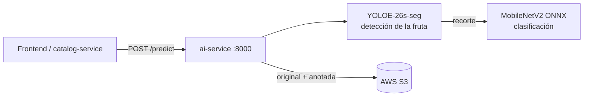

# AgroTrace AI Service

Microservicio de **visión artificial** del sistema **AgroTrace**. Recibe la foto de una fruta, la localiza, la clasifica según su estado de calidad (`Fresh`, `Mild` o `Rotten`) y guarda la imagen original y la anotada en AWS S3.

---

## Arquitectura

A diferencia del [backend](../backend/README.md) (NestJS, comunicación por TCP), este servicio está hecho en **Python con FastAPI** y se expone por **HTTP**, ya que los microservicios de NestJS usan un TCP propio que FastAPI no habla. No usa base de datos: solo predice y almacena las fotos en S3.



### Flujo de `POST /predict`

1. Valida la imagen: que exista, que no supere el tamaño máximo y que su tipo real (por contenido, no por extensión) sea PNG, JPG, JPEG o WEBP.
2. **Detecta** la fruta con YOLOE y toma la detección de mayor confianza. Si no encuentra ninguna, responde `422`.
3. **Recorta** la fruta y la **clasifica** con el modelo ONNX. El clasificador se entrenó con recortes de YOLOE, no con fotos completas, por eso el fondo se descarta antes de clasificar.
4. Dibuja el recuadro verde sobre la foto y sube a S3 la imagen **original** y la **anotada** bajo el mismo UUID.
5. Responde con la clase, la confianza y las llaves de ambas imágenes en S3.

### Modelos

| Archivo (`model/`) | Tarea | Descripción |
|---|---|---|
| `yoloe-26s-seg-fruits.pt` | Detección | YOLOE-26s-seg, localiza la fruta en la foto |
| `tf_model_mobilenetv2.onnx` | Clasificación | MobileNetV2 exportado a ONNX. Redimensiona y normaliza internamente, por lo que recibe píxeles crudos 0–255 |

Clases: `Fresh` (fresca), `Mild` (estado intermedio) y `Rotten` (podrida).

---

## Tecnologías

- **Framework:** [FastAPI](https://fastapi.tiangolo.com/)
- **Lenguaje:** Python 3.12
- **Gestor de paquetes:** [uv](https://docs.astral.sh/uv/)
- **Inferencia:** [ONNX Runtime](https://onnxruntime.ai/) (clasificador) y [Ultralytics](https://docs.ultralytics.com/) (detector)
- **Imágenes:** Pillow y `python-magic` (detección del tipo de archivo)
- **Almacenamiento:** AWS S3 con `boto3`
- **Configuración:** `pydantic-settings`
- **Pruebas:** pytest y pytest-cov

---

## Estructura

```
ai-service/
├── model/                 # Modelos entrenados (.pt y .onnx)
├── src/
│   ├── main.py            # App FastAPI, ciclo de vida y endpoint /predict
│   ├── models.py          # DetectionResult
│   ├── core/config.py     # Configuración desde variables de entorno
│   ├── inference/
│   │   ├── detector.py    # Carga de YOLOE, búsqueda de la fruta y recuadro
│   │   ├── engine.py      # Carga del ONNX y clasificación
│   │   └── pipeline.py    # Detectar → recortar → clasificar
│   └── storage/s3.py      # Subida a S3, llaves únicas y URLs prefirmadas
└── tests/                 # Pruebas unitarias y fixtures
```

---

## Prerrequisitos

- [Python](https://www.python.org/) 3.12 o superior
- [uv](https://docs.astral.sh/uv/): `pip install uv`
- Un bucket de **AWS S3** y credenciales con permiso de escritura sobre él
- **libmagic** en Linux/macOS (`apt install libmagic1` / `brew install libmagic`). En Windows ya se instala con `python-magic-bin`.

---

## Instalación y configuración

1. **Instalar las dependencias:**

   ```bash
   cd ai-service
   uv sync
   ```

2. **Configurar las variables de entorno:** copia `.env.example` a `.env` y completa los valores.

   ```bash
   cp .env.example .env
   ```

### Variables de entorno

| Variable | Descripción | Ejemplo |
|---|---|---|
| `AWS_ACCESS_KEY_ID` | Clave de acceso de AWS | `AKIA...` |
| `AWS_SECRET_ACCESS_KEY` | Clave secreta de AWS | `tu_clave_secreta` |
| `AWS_REGION` | Región del bucket | `us-east-1` |
| `S3_BUCKET_NAME` | Bucket donde se guardan las imágenes | `agrotrace-images` |
| `SONAR_TOKEN` | Token de SonarQube (solo para análisis de calidad, el servicio no lo usa) | `tu_token` |

> Los archivos de `model/` deben existir al arrancar; si falta alguno, el servicio falla de inmediato en lugar de descargar pesos oficiales.

---

## Ejecución

### Desarrollo

```bash
uv run fastapi dev src/main.py
```

### Producción

```bash
uv run fastapi run src/main.py --port 8000
```

El servicio queda disponible en `http://localhost:8000`.

---

## Documentación de la API (Swagger)

Con el servicio levantado, abre http://localhost:8000/docs (la ruta `/` redirige ahí). El documento OpenAPI está en http://localhost:8000/openapi.json.

### `POST /predict`

Recibe la imagen como `multipart/form-data` en el campo `image`.

```bash
curl -X POST http://localhost:8000/predict -F "image=@tests/fixtures/banana.jpeg"
```

**Respuesta `200`:**

```json
{
  "class": "Fresh",
  "confidence": 0.97,
  "original_key": "original/3f2b8c1e-....jpeg",
  "annotated_key": "annotated/3f2b8c1e-....jpeg"
}
```

| Campo | Descripción |
|---|---|
| `class` | `Fresh`, `Mild` o `Rotten` |
| `confidence` | Probabilidad de la clase predicha (0–1) |
| `original_key` | Llave en S3 de la foto original (`original/<uuid>.<ext>`) |
| `annotated_key` | Llave en S3 de la foto con el recuadro de la fruta (`annotated/<uuid>.jpeg`) |

**Errores:**

| Código | Causa |
|---|---|
| `400` | Archivo ausente o vacío, supera el tamaño máximo (5 MB) o tipo no soportado |
| `422` | No se detectó ninguna fruta en la imagen |

---

## Pruebas

```bash
uv run pytest
```

Con reporte de cobertura:

```bash
uv run pytest --cov=src --cov-report=term-missing
```

---

## Autores

- Valentina Cano Meneses
- Juan Jose Lopera Londoño
