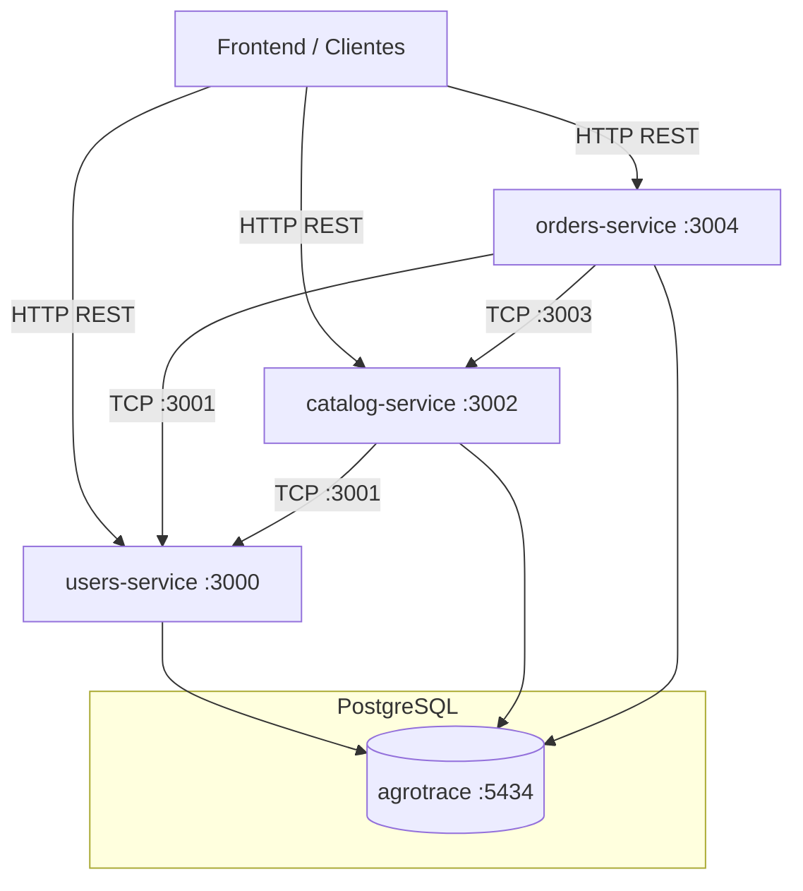

# AgroTrace Backend

Backend oficial del sistema **AgroTrace**, diseñado para conectar de manera segura y transparente a compradores (personas y negocios) con agricultores locales mediante una arquitectura escalable de microservicios.

---

## Arquitectura

El sistema está construido como un **monorepo con microservicios** en NestJS. Los servicios se comunican internamente mediante **TCP** y exponen endpoints HTTP independientes hacia el cliente (frontend).



### Servicios

| Servicio | Puerto HTTP | Puerto TCP (interno) | Responsabilidad |
|---|---|---|---|
| `users-service` | 3000 | 3001 | Registro, autenticación (JWT), roles (`Persona`, `Negocio`, `Agricultor`, `Admin`), perfiles y validaciones de identidad. |
| `catalog-service` | 3002 | 3003 | Catálogo maestro de productos agrícolas y ofertas publicadas por los agricultores, con validaciones de calidad mediante visión artificial. |
| `orders-service` | 3004 | 3005 | Ciclo de vida de los pedidos, límites de compra, códigos de entrega seguros de 6 dígitos y métricas de ventas. |
| `libs/shared` | — | — | Librería transversal: guards globales (`JwtAuthGuard`, `RolesGuard`), decoradores de roles, enumerados y servicios de validación TCP. |

### Decisión de diseño: base de datos compartida

Los tres microservicios usan **una única base de datos PostgreSQL** (`agrotrace`). Esto se hizo de forma **consciente**, apartándose del principio clásico de "una base de datos por servicio", por la siguiente razón:

- **Reducción de costos:** en un escenario real, mantener una sola instancia de base de datos evita multiplicar los costos de infraestructura, administración y respaldos que implicaría una instancia por servicio.

Este enfoque prioriza la simplicidad operativa y el costo. Si el sistema escalara, la base de datos podría separarse por servicio.

---

## Tecnologías

- **Framework:** [NestJS](https://nestjs.com/) (Node.js)
- **Lenguaje:** TypeScript
- **Base de datos:** PostgreSQL con [TypeORM](https://typeorm.io/)
- **Gestor de paquetes:** [pnpm](https://pnpm.io/) (workspaces)
- **Autenticación:** JSON Web Tokens (JWT)
- **Comunicación:** HTTP (REST) y TCP (microservicios NestJS)
- **Documentación de código:** JSDoc en clases, servicios, entidades y controladores

---

## Prerrequisitos

- [Node.js](https://nodejs.org/) 18 o superior
- [pnpm](https://pnpm.io/): `npm install -g pnpm`
- PostgreSQL activo, con una base de datos llamada `agrotrace`

---

## Instalación y configuración

1. **Clonar el repositorio e instalar dependencias:**

   ```bash
   git clone <url-del-repositorio>
   cd backend
   pnpm install
   ```

2. **Configurar las variables de entorno:** en la carpeta de cada microservicio dentro de `apps/`, copia `.env.example` a `.env` y completa los valores.

   ```bash
   cp apps/users-service/.env.example apps/users-service/.env
   cp apps/catalog-service/.env.example apps/catalog-service/.env
   cp apps/orders-service/.env.example apps/orders-service/.env
   ```

### Variables de entorno

| Variable | Servicios | Descripción | Ejemplo |
|---|---|---|---|
| `NODE_ENV` | Todos | Entorno de ejecución | `development` |
| `HTTP_PORT` | Todos | Puerto HTTP del servicio | `3000` / `3002` / `3004` |
| `HOST` | Todos | Host del microservicio TCP | `0.0.0.0` |
| `MICROSERVICE_PORT` | Todos | Puerto TCP interno | `3001` / `3003` / `3005` |
| `DATABASE_HOST` | Todos | Host de PostgreSQL | `localhost` |
| `DATABASE_PORT` | Todos | Puerto de PostgreSQL | `5434` |
| `DATABASE_USERNAME` | Todos | Usuario de la base de datos | `tu_usuario` |
| `DATABASE_PASSWORD` | Todos | Contraseña de la base de datos | `tu_contraseña` |
| `DATABASE_NAME` | Todos | Base de datos compartida | `agrotrace` |
| `JWT_SECRET` | Todos | Secreto JWT. **Debe ser el mismo en los tres servicios.** | `cambia-este-secreto` |
| `JWT_EXPIRES_IN` | `users-service` | Duración del token | `15m` |
| `USERS_SERVICE_HOST` / `USERS_SERVICE_PORT` | `catalog`, `orders` | Ubicación TCP de `users-service` | `localhost` / `3001` |
| `CATALOG_SERVICE_HOST` / `CATALOG_SERVICE_PORT` | `orders` | Ubicación TCP de `catalog-service` | `localhost` / `3003` |
| `CORS_ORIGIN` | Todos (opcional) | URL(s) del frontend separadas por coma. Si se omite, se acepta cualquier origen (solo desarrollo). | `http://localhost:5173` |

> Los servicios consumidos por TCP (`users-service` y `catalog-service`) deben estar levantados antes que quienes los llaman.

---

## Ejecución

### Desarrollo

Cada microservicio se levanta de forma independiente, en una terminal distinta. Se recomienda este orden:

```bash
pnpm --filter users-service run start:dev
pnpm --filter catalog-service run start:dev
pnpm --filter orders-service run start:dev
```

### Producción

```bash
pnpm --filter users-service run build
pnpm --filter users-service run start:prod
```

Repite el procedimiento para `catalog-service` y `orders-service`.

---

## Documentación del código

Todo el código fuente cuenta con anotaciones JSDoc detalladas en clases, métodos, DTOs y entidades, para facilitar el mantenimiento y las herramientas de autocompletado.

---

## Autores

- Valentina Cano Meneses
- Juan Jose Lopera Londoño
