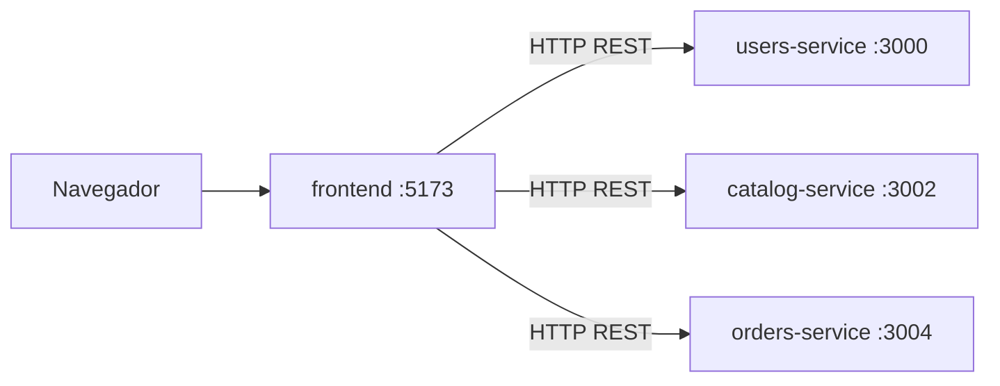

# AgroTrace Frontend

Aplicación web del sistema **AgroTrace**, una plataforma que conecta de manera segura y transparente a compradores (personas y negocios) con agricultores locales. Desde ella los usuarios se registran, exploran el catálogo de cosechas, publican ofertas validadas por inteligencia artificial y gestionan sus pedidos.

---

## Descripción

El frontend es una **SPA (Single Page Application)** hecha con React y TypeScript que consume por HTTP los microservicios del [backend](../backend/README.md). La interfaz se adapta al rol de quien inicia sesión:

| Rol | Página de inicio | Qué puede hacer |
|---|---|---|
| `Persona` / `Negocio` | `/explorar` | Explorar y filtrar el catálogo, ver el detalle de una oferta, hacer pedidos y consultar sus compras. |
| `Agricultor` | `/perfil` | Publicar cosechas, ver sus ofertas y los pedidos recibidos. |
| `Admin` | `/catalogo-maestro` | Gestionar el catálogo maestro: ver los productos por categoría y agregar categorías y productos. No tiene perfil comercial ni pedidos, así que esas opciones se ocultan en el menú. |

### Publicación con validación de calidad

El agricultor publica una cosecha en **tres pasos**:

1. **Datos de la cosecha:** producto, cantidad, precio en COP y descripción opcional.
2. **Cuándo se recoge:** fecha de recolección opcional.
3. **Revisar y publicar:** el `catalog-service` envía la foto al `ai-service` y la pantalla muestra la calidad asignada y la foto con el recuadro de la fruta detectada. Si la fruta se clasifica como podrida, la oferta no se puede crear.

### Arquitectura



El frontend no se comunica con el `ai-service` directamente: la validación de calidad de las fotos la dispara el `catalog-service`.

### Rutas

| Ruta | Vista | Descripción |
|---|---|---|
| `/` | `Landing` | Página de presentación pública. |
| `/login` | `LoginPage` | Inicio de sesión y registro (`/login?modo=registro`). `/register` redirige aquí. |
| `/perfil` | `PerfilPage` | Perfil del usuario. Es la página de inicio del agricultor. |
| `/explorar` | `ExplorarPage` | Catálogo de ofertas. Es la página de inicio de los compradores. |
| `/explorar/:offertId` | `DetalleProductoPage` | Detalle de una oferta. |
| `/filtros` | `FilterPage` | Filtros del catálogo. |
| `/publicar` | `PublicarPage` | Publicación de cosechas en tres pasos, con revisión de la IA (agricultor). |
| `/catalogo-maestro` | `CatalogoMaestroPage` | Gestión del catálogo maestro de productos (administrador). |
| `/pedidos` | `PedidosPage` | Listado de compras o de pedidos recibidos, según el rol. |
| `/pedidos/:orderId` | `DetallePedidoPage` | Detalle de un pedido. |

Las rutas de la aplicación (todas menos `/`, `/login` y `/register`) comparten `AppLayout` y requieren una sesión activa gestionada por `SesionProvider`.

### Sesión

Al iniciar sesión, `SesionProvider` guarda en `localStorage` el `accessToken`, el `refreshToken` y los datos del usuario. Al cerrar sesión se borran y se revoca el refresh token en el `users-service`. Si una petición responde `401` (token vencido), la sesión se cierra y el usuario vuelve a `/login`.

---

## Tecnologías

- **Librería:** [React](https://react.dev/) 19
- **Lenguaje:** TypeScript
- **Empaquetador:** [Vite](https://vite.dev/)
- **Enrutamiento:** [React Router](https://reactrouter.com/) 7
- **Estilos:** [Tailwind CSS](https://tailwindcss.com/) 4
- **Gestor de paquetes:** [pnpm](https://pnpm.io/)
- **Pruebas:** [Vitest](https://vitest.dev/) y Testing Library
- **Calidad de código:** ESLint, Prettier y SonarQube
- **Despliegue:** Docker y Nginx
- **Documentación de código:** JSDoc en componentes, funciones y módulos

---

## Estructura

```
frontend/
├── public/                # Archivos estáticos
├── src/
│   ├── main.tsx           # Punto de entrada
│   ├── App.tsx            # Rutas y proveedor de sesión
│   ├── index.css          # Estilos globales (Tailwind)
│   ├── config/env.ts      # Lectura y validación de variables de entorno
│   └── routes/
│       ├── routes.ts      # Rutas centralizadas y redirección por rol
│       ├── session-context.tsx  # Contexto de sesión
│       ├── auth-api.ts    # Cliente de users-service (login y registro)
│       ├── profile-api.ts # Cliente de catálogo, ofertas y pedidos
│       ├── formato.ts     # Utilidades de formato
│       ├── Landing.tsx
│       ├── auth/          # Inicio de sesión y registro
│       └── app/           # Vistas autenticadas (explorar, publicar, pedidos, catálogo maestro...)
├── test/                  # Pruebas unitarias (reflejan la estructura de src/)
├── Dockerfile             # Build multi-etapa con Nginx
└── nginx.conf             # Configuración de Nginx para la SPA
```

---

## Prerrequisitos

- [Node.js](https://nodejs.org/) 22 o superior
- [pnpm](https://pnpm.io/): `npm install -g pnpm`
- Los microservicios del [backend](../backend/README.md) levantados (o el entorno completo con Docker, ver [Docker](#docker))

---

## Instalación y configuración

1. **Instalar las dependencias:**

   ```bash
   cd frontend
   pnpm install
   ```

2. **Configurar las variables de entorno:** copia `.env.example` a `.env`. Los valores por defecto ya apuntan a los puertos locales del backend.

   ```bash
   cp .env.example .env
   ```

### Variables de entorno

| Variable | Descripción | Ejemplo |
|---|---|---|
| `VITE_USERS_API_URL` | URL del `users-service` (login y registro) | `http://localhost:3000` |
| `VITE_CATALOG_API_URL` | URL del `catalog-service` (catálogo y ofertas) | `http://localhost:3002` |
| `VITE_ORDERS_API_URL` | URL del `orders-service` (pedidos) | `http://localhost:3004` |
| `SONAR_HOST_URL` | URL de SonarQube (solo para análisis de calidad) | `http://localhost:9000` |
| `SONAR_TOKEN` | Token de SonarQube (solo para análisis de calidad) | `tu_token` |

> Las tres variables `VITE_*` son obligatorias: si falta alguna, la aplicación falla al arrancar con un mensaje que indica cuál. Vite las **incrusta al compilar**, así que cambiarlas exige volver a hacer el build.

> En desarrollo, si `CORS_ORIGIN` está comentado en el backend, se acepta cualquier origen. Si está definido, debe incluir la URL del frontend (por ejemplo `http://localhost:5173`).

---

## Ejecución

### Desarrollo

```bash
pnpm dev
```

La aplicación queda disponible en `http://localhost:5173`.

### Producción

```bash
pnpm build
pnpm preview
```

`pnpm build` revisa los tipos con `tsc` y genera la carpeta `dist/`. `pnpm preview` la sirve localmente para comprobarla.

### Docker

El `Dockerfile` compila la aplicación y la sirve con Nginx en el puerto 80. Las variables `VITE_*` se reciben como *build args*. El `docker-compose.yml` de la raíz del monorepo levanta el frontend junto con los demás servicios y lo publica en `http://localhost:5173`:

```bash
docker compose up --build frontend
```

---

## Scripts

| Comando | Descripción |
|---|---|
| `pnpm dev` | Inicia el servidor de desarrollo. |
| `pnpm build` | Revisa los tipos y compila el proyecto para producción. |
| `pnpm preview` | Sirve localmente la compilación de producción. |
| `pnpm lint` | Revisa el código con ESLint. |
| `pnpm test` | Ejecuta las pruebas con Vitest. |
| `pnpm test:coverage` | Ejecuta las pruebas y genera el reporte de cobertura. |
| `pnpm sonar` | Ejecuta las pruebas con cobertura y envía el análisis a SonarQube. |

---

## Pruebas

Las pruebas viven en `test/` y usan Vitest con Testing Library sobre `jsdom`.

```bash
pnpm test
```

Con reporte de cobertura (se genera en `coverage/`):

```bash
pnpm test:coverage
```

---

## Soporte

Si encuentras un error o tienes una duda, abre un *issue* en el repositorio o contacta a los autores.

---

## Autores

- Valentina Cano Meneses
- Juan Jose Lopera Londoño
